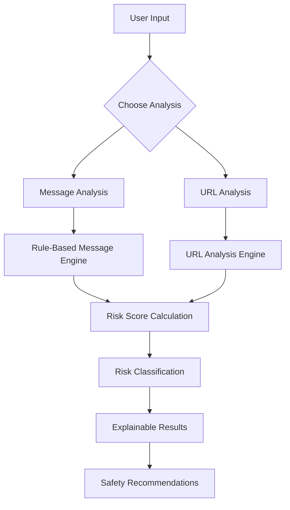

# 🛡️ ScamShield

### Detect Suspicious Messages. Identify Phishing Links. Stay Safe Online.

ScamShield is an open-source scam and phishing detection platform designed to help users identify suspicious messages and potentially dangerous URLs before interacting with them.

It analyzes message content and URL characteristics, identifies suspicious patterns, calculates a risk score, and provides understandable explanations and safety recommendations.

The goal is simple: make online safety easier and more accessible for everyone.

<p align="center">
  
  
  
  
  
</p>

---

## 📌 Table of Contents

- [About the Project](#-about-the-project)
- [Why ScamShield?](#-why-scamshield)
- [Features](#-features)
- [How It Works](#-how-it-works)
- [Technology Stack](#-technology-stack)
- [Project Structure](#-project-structure)
- [Installation and Setup](#-installation-and-setup)
- [API Documentation](#-api-documentation)
- [Example API Requests](#-example-api-requests)
- [Testing](#-testing)
- [Security and Privacy](#-security-and-privacy)
- [Limitations](#-limitations)
- [Future Improvements](#-future-improvements)
- [Contributing](#-contributing)
- [Author](#-author)
- [License](#-license)

---

## 🚀 About the Project

Online scams are becoming increasingly sophisticated. Fraudsters use fake banking messages, phishing websites, misleading URLs, fake KYC notifications, and fraudulent payment requests to trick users into revealing sensitive information.

Many users struggle to distinguish legitimate messages from scams.

**ScamShield** aims to address this problem through an easy-to-use web application that analyzes suspicious messages and URLs.

It uses a Python-based detection engine to identify suspicious keywords, phishing indicators, domain impersonation, misleading subdomains, and other potentially dangerous URL characteristics.

Rather than simply displaying a warning, ScamShield also explains why a message or link may be suspicious and recommends what the user should do next.

## 🎯 Why ScamShield?

ScamShield focuses on three important cybersecurity challenges:

| Problem | ScamShield's approach |
|---|---|
| Fake messages | Analyze suspicious language and scam-related keywords |
| Phishing websites | Inspect URL structure and suspicious domain patterns |
| Brand impersonation | Identify common lookalike-domain patterns |

The project is particularly relevant to everyday internet users who receive suspicious SMS messages, WhatsApp messages, and unexpected links.

## ✨ Features

### 1. Message Scam Detection

- Analyze user-submitted messages.
- Identify suspicious phrases and scam-related keywords.
- Calculate a risk score.
- Display a verdict with understandable reasons.
- Provide safety recommendations.

### 2. Suspicious URL Detection

ScamShield checks URLs for several suspicious characteristics:

- Spoofed and lookalike domains.
- Brand impersonation patterns.
- Misleading subdomains.
- URL shorteners.
- Suspicious keywords such as `login`, `verify`, `billing`, and `payment`.
- Raw IP-address-based links.
- HTTP connections.
- Encoded internationalized domain names.
- Deceptive URL structures.

### 3. Risk Assessment

The detection engine provides:

| Risk level | Meaning |
|---|---|
| Low | No configured warning patterns detected |
| Medium | One or more suspicious characteristics detected |
| High | Multiple or particularly concerning indicators detected |

### 4. Explainable Results

Instead of showing only a score, ScamShield provides:

- Detection verdict.
- Risk score.
- Suspicious indicators.
- Reasons behind the warning.
- Recommended safety actions.

### 5. User-Friendly Interface

- Responsive web interface.
- Message and URL analysis tabs.
- Sample suspicious messages.
- Result cards and risk indicators.
- Safety tips.
- Report and feedback interface.

> Audio analysis is currently planned for a future release.

---

## ⚙️ How It Works

ScamShield follows a simple analysis pipeline.



### Message Analysis

1. The user submits a suspicious message.
2. The backend receives the message through FastAPI.
3. The detection engine checks configured scam patterns.
4. Suspicious indicators contribute to the risk score.
5. The system generates a verdict and safety recommendations.

### URL Analysis

1. The user submits a URL.
2. ScamShield parses the hostname and URL structure.
3. It checks suspicious keywords, URL shorteners, IP addresses, and domain characteristics.
4. It evaluates possible brand impersonation and misleading subdomains.
5. It generates a risk score and warning.

**Important:** URL analysis is performed using URL characteristics. ScamShield does not need to open the submitted website to perform these checks.

---

## 🧰 Technology Stack

| Technology | Purpose |
|---|---|
| Python | Core application and detection logic |
| FastAPI | Backend REST API |
| Pydantic | Request validation |
| HTML5 | Frontend structure |
| CSS3 | Styling and responsive design |
| JavaScript | Frontend interactions |
| tldextract | Registered-domain identification |
| pytest | Automated testing |
| Uvicorn | ASGI application server |

---

## 📂 Project Structure

```text
ScamShield/
│
├── app/
│   ├── __init__.py
│   ├── main.py
│   ├── rules_engine.py
│   └── url_checker.py
│
├── frontend/
│   ├── index.html
│   ├── style.css
│   └── app.js
│
├── tests/
│   ├── test_api.py
│   ├── test_frontend_assets.py
│   ├── test_url_checker.py
│   └── test_urls.py
│
├── requirements.txt
├── .gitignore
└── README.md
```

---

## 💻 Installation and Setup

Follow these steps to run ScamShield locally.

### Prerequisites

- Python 3.12 or later.
- Git.
- Visual Studio Code (recommended).

### Step 1: Clone the repository

```bash
git clone https://github.com/subrata131/ScamShield.git
```

### Step 2: Open the project directory

```bash
cd ScamShield
```

### Step 3: Create a virtual environment

**Windows:**

```powershell
python -m venv .venv
```

### Step 4: Activate the virtual environment

```powershell
.\.venv\Scripts\Activate.ps1
```

If PowerShell activation is unavailable, you can use the virtual environment's Python executable directly.

### Step 5: Install dependencies

```powershell
python -m pip install -r requirements.txt
```

### Step 6: Run the application

```powershell
python -m uvicorn app.main:app --reload
```

### Step 7: Open ScamShield

Visit the following address in your browser:

**http://127.0.0.1:8000**

### API Documentation

FastAPI interactive documentation:

**http://127.0.0.1:8000/docs**

---

## 🔌 API Documentation

ScamShield provides REST API endpoints for message and URL analysis.

| Method | Endpoint | Description |
|---|---|---|
| GET | `/` | Serves the frontend |
| GET | `/api/health` | Checks backend health |
| POST | `/api/analyze` | Analyzes a suspicious message |
| POST | `/api/analyze/url` | Analyzes a suspicious URL |

### Health Check

```http
GET /api/health
```

Example response:

```json
{
  "status": "healthy",
  "model_loaded": false
}
```

### Message Analysis

```http
POST /api/analyze
Content-Type: application/json
```

Example request:

```json
{
  "message": "Your KYC has expired. Share your OTP immediately to avoid account blocking."
}
```

### URL Analysis

```http
POST /api/analyze/url
Content-Type: application/json
```

Example request:

```json
{
  "url": "https://www.amaz0n-billing.com"
}
```

The URL analysis response includes fields such as:

- `hostname`
- `registered_domain`
- `verdict`
- `risk_level`
- `risk_score`
- `reasons`
- `advice`

Exact responses depend on the configured detection rules.

---

## 🧪 Testing

ScamShield uses pytest for automated testing.

Run the test suite:

```bash
python -m pytest -v
```

The tests cover areas including:

- API health checks.
- Message analysis.
- Suspicious message detection.
- Empty input validation.
- URL analysis.
- Suspicious URL detection.
- Frontend asset availability.

---

## 🔐 Security and Privacy

Security is an important consideration in ScamShield.

- Submitted URLs are analyzed as text rather than automatically opened.
- The URL checker does not fetch arbitrary user-submitted websites.
- The application provides warnings based on configured detection rules.
- Users are advised not to share OTPs, passwords, banking credentials, or sensitive personal information.

**Disclaimer:** ScamShield is an educational cybersecurity project. It is not a replacement for professional security software or official fraud investigation services. A low-risk result does not guarantee that a message or website is safe.

---

## ⚠️ Limitations

ScamShield is currently under active development.

Current limitations include:

- Detection depends on configured rules and heuristics.
- New and previously unseen scam techniques may not be detected.
- URL checks do not establish website ownership or reputation.
- Brand impersonation detection can produce false positives.
- Machine-learning-based detection is not yet implemented.
- Audio scam detection is not yet implemented.
- Report and feedback functionality is currently a frontend demonstration rather than a persistent reporting service.

---

## 🔮 Future Improvements

Planned improvements include:

- [ ] Machine-learning-based scam message classification.
- [ ] Improved phishing URL detection.
- [ ] Integration with domain reputation services.
- [ ] Better detection of Unicode and character-substitution attacks.
- [ ] Hindi and Bengali language support.
- [ ] Audio and call scam analysis.
- [ ] Persistent user reporting and feedback.
- [ ] Improved security testing and false-positive evaluation.
- [ ] Deployment of the application for public access.

---

## 🤝 Contributing

Contributions, suggestions, bug reports, and feature requests are welcome!

If you want to contribute:

1. Fork this repository.
2. Create a new feature branch.
3. Make your changes.
4. Run the test suite.
5. Submit a pull request.

```bash
git checkout -b feature/your-feature-name
git add .
git commit -m "Add: your feature description"
git push origin feature/your-feature-name
```

---

## 👨‍💻 Author

**Subrata Das**

Computer Science and Engineering Student | Python Backend Developer

- GitHub: [@subrata131](https://github.com/subrata131)

Interested in Python development, backend engineering, cybersecurity, and building practical software solutions.

---

## 📜 License

This project is licensed under the MIT License.

See the [LICENSE](LICENSE) file for details.

---

<p align="center">
  <b>🛡️ ScamShield — Think Before You Click.</b>
  <br>
  <i>Building a safer digital environment, one detection at a time.</i>
</p>
